## MLOps Experimental Learning Assignment: End-to-End ML Model Development, CI/CD, and Production Deployment Experimental Learning

* Course: Machine Learning Operations (MLOps) (AIMLCZG523)
* Total marks: 50
* Student: SHREYES RAM V.
* BITS ID: 2025AE05177
* Repository: [https://github.com/ShreyStar02/MLOps_Assignment1_Shrey](https://github.com/ShreyStar02/MLOps_Assignment1_Shrey)
**Video recording:** [Demo video](demo_video.mp4)

## Objective and problem

Design, develop, and deploy a scalable, reproducible machine learning solution using modern MLOps best practices, including practical automation, experiment tracking, CI/CD, containerization, deployment, and monitoring.

The solution classifies heart-disease presence from the Cleveland subset of
the UCI Heart Disease dataset and serves predictions through a monitored API.

## 1. Data acquisition and exploratory analysis

The dataset was acquired from the [UCI Machine Learning Repository](https://archive.ics.uci.edu/dataset/45/heart+disease)
using `scripts/download_data.py`. Cleaning produced 303 rows, 13 input features,
and a binary target. The target distribution is 164 records
without disease and 139 with disease. The raw `ca` and
`thal` columns contained 4 and 2
missing values respectively; these were retained for pipeline imputation.

The analysis includes class balance, numeric distributions, categorical counts,
feature boxplots, and a correlation heatmap. These figures were generated from
the processed data by `src/eda.py`.

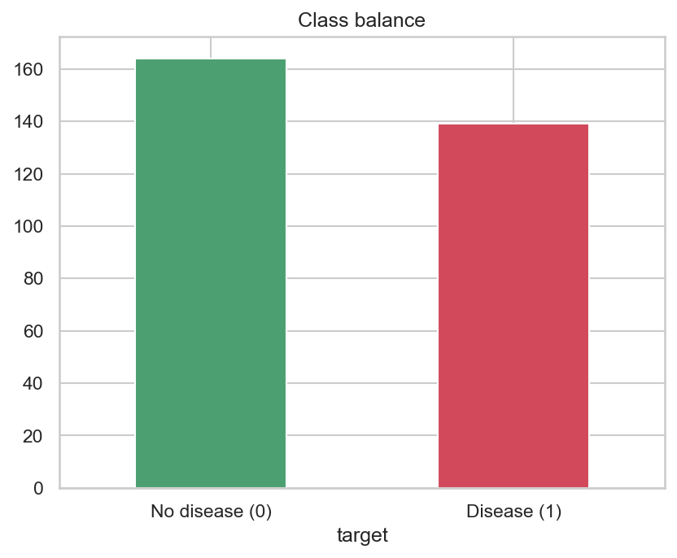

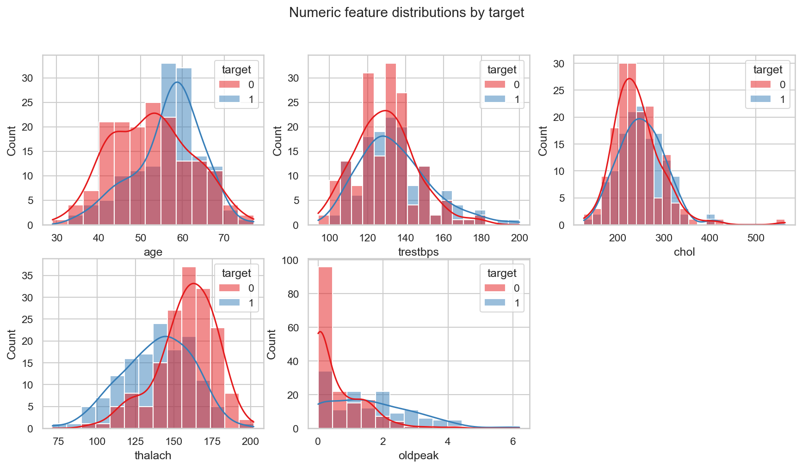

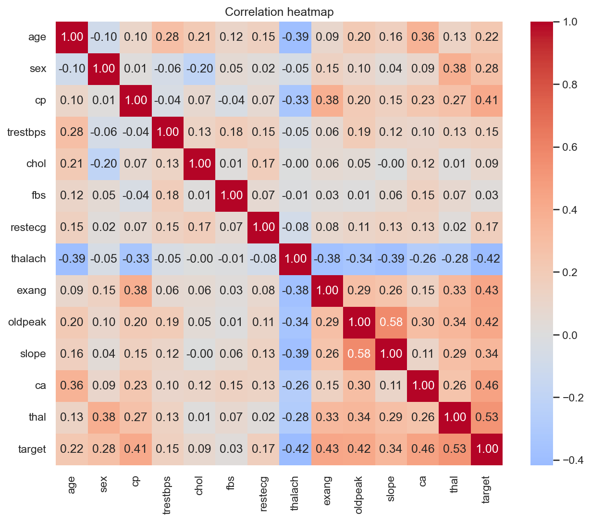

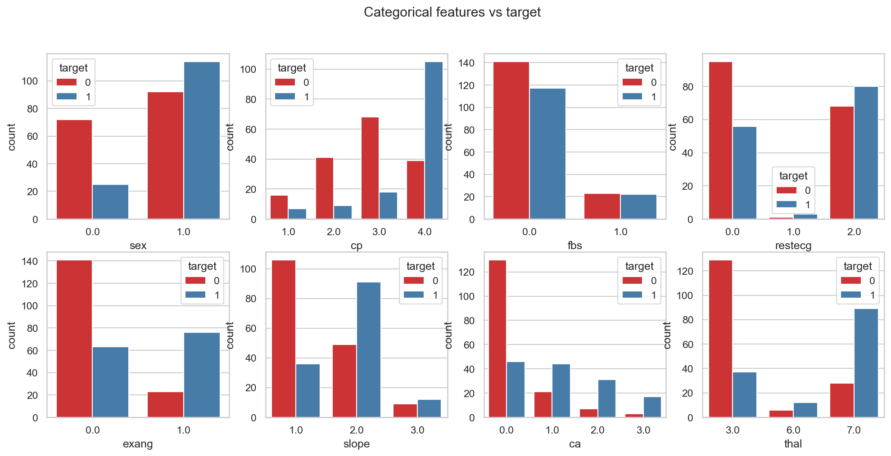

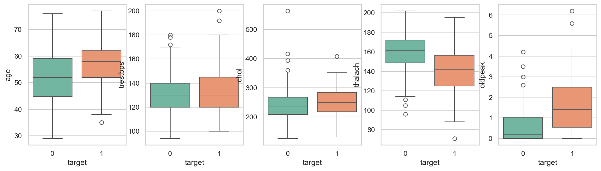

## 2. Feature engineering and model development

The shared preprocessing pipeline creates an age bucket (`under_45`, `45_to_59`,
or `60_plus`), median-imputes and standardizes numeric features, and most-frequent-
imputes and one-hot encodes categorical features. Unknown categories are ignored
at inference time. The feature inputs are age, trestbps, chol, thalach, oldpeak, sex, cp, fbs, restecg, exang, slope, ca, thal.

Three classifiers were tuned with `GridSearchCV` and evaluated with stratified
5-fold cross-validation: logistic regression, random forest, and gradient
boosting. The highest mean CV ROC-AUC selected **logistic_regression**. Its selected
parameters are `{'clf__C': 0.1}`. Metrics are from
`models/metadata.json`.

| Metric | Cross-validation mean | Test set |
| --- | ---: | ---: |
| ROC-AUC | 0.901 | 0.965 |
| Accuracy | 0.835 | 0.885 |
| Precision | 0.857 | 0.839 |
| Recall | 0.774 | 0.929 |
| F1 | 0.810 | 0.881 |

| Model | CV ROC-AUC | CV Accuracy | CV Precision | CV Recall | CV F1 | Test ROC-AUC | Test Accuracy | Test Precision | Test Recall | Test F1 |
|-------|-----------:|------------:|-------------:|----------:|------:|-------------:|-------------:|---------------:|-----------:|--------:|
| Logistic Regression | 0.901 | 0.835 | 0.857 | 0.774 | 0.810 | 0.965 | 0.885 | 0.839 | 0.929 | 0.881 |
| Random Forest | 0.901 | 0.822 | 0.824 | 0.783 | 0.800 | 0.951 | 0.869 | 0.812 | 0.929 | 0.867 |
| Gradient Boosting | 0.897 | 0.839 | 0.876 | 0.765 | 0.812 | 0.943 | 0.869 | 0.857 | 0.857 | 0.857 |

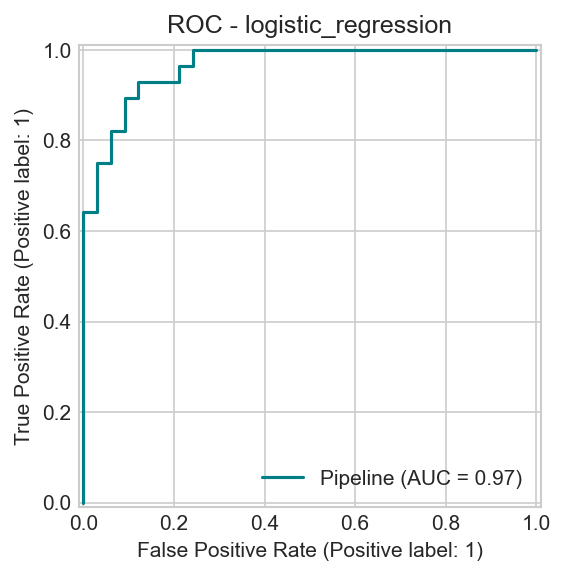

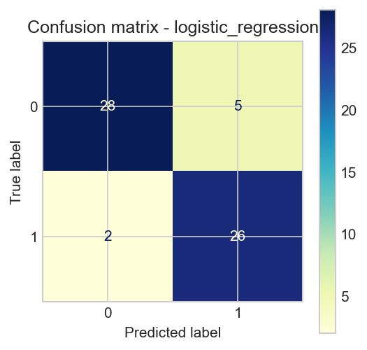

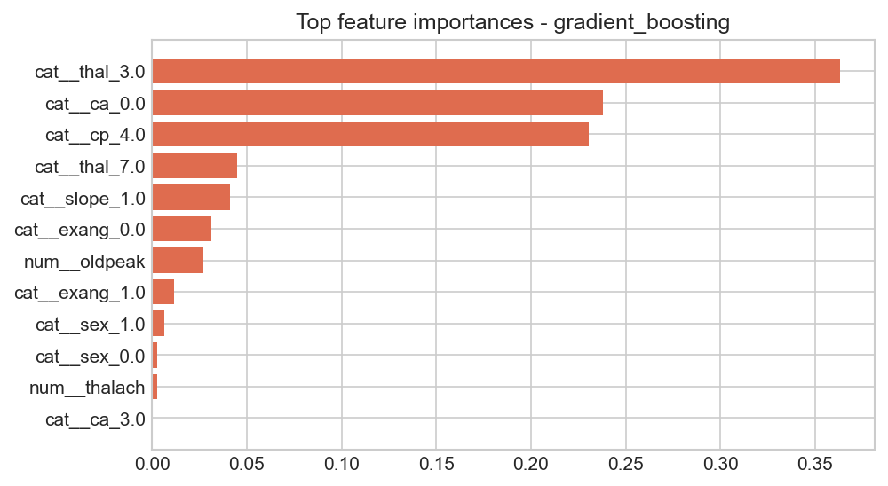

## 3. Experiment tracking

MLflow records parameters, cross-validation and holdout metrics, model artifacts,
and evaluation plots for all candidate runs. The tracking store is `mlflow.db`;
the selected model run ID is `67f5ff4ff4f6493ea821ab831b0d4b2a`.

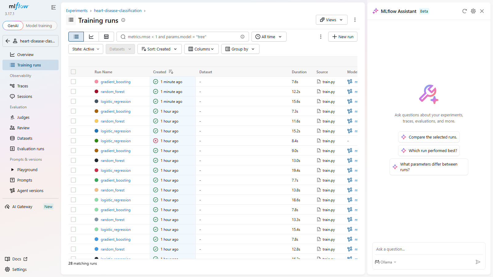

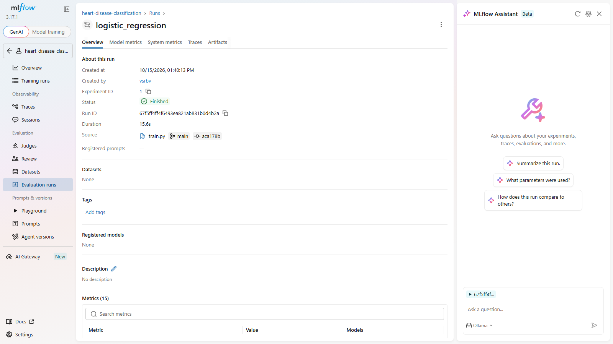

## 4. Model packaging and reproducibility

The selected scikit-learn 1.7.2 preprocessing-and-classification pipeline is
serialized to `models/model.joblib`; `models/metadata.json` stores selected
parameters, metrics, feature names, and run ID. Install dependencies and run
the workflow from the repository root:

```powershell
python -m venv .venv
& .venv/Scripts/Activate.ps1
python -m pip install -r requirements.txt
python scripts/download_data.py
python src/eda.py
python src/train.py
pytest -v
flake8 src api scripts tests
```

## 5. CI/CD and automated testing

The GitHub Actions workflow checks out the repository, installs Python 3.11
dependencies, runs Flake8 and pytest with coverage, downloads and cleans data,
trains and logs models, builds the API image, smoke-tests `/health` and
`/predict`, and uploads training, coverage, model, and plot artifacts. The local
verification run passed all 14 tests and Flake8.

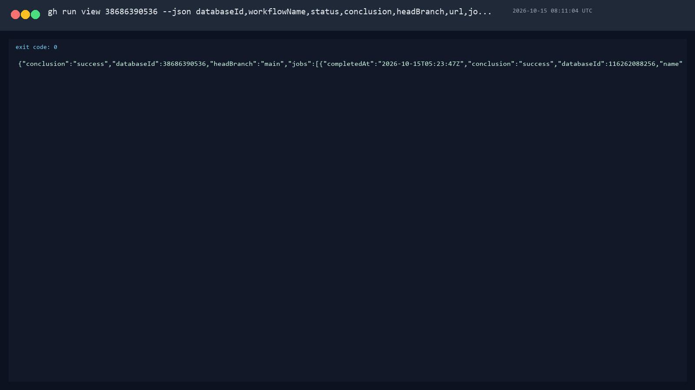

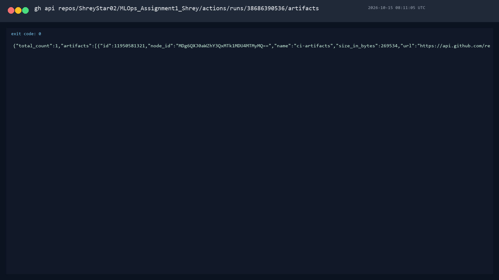

## 6. Containerized API

The FastAPI service accepts validated patient features at `POST /predict` and
returns the risk class, risk label, confidence, and disease probability.
`GET /health`, `GET /model-info`, `GET /metrics`, and `/docs` support health
checks, metadata, monitoring, and API exploration. Request logging and
Prometheus counters track requests, latency, prediction labels, and failures.

The API container was built from the project Dockerfile and exercised with
real JSON prediction requests.

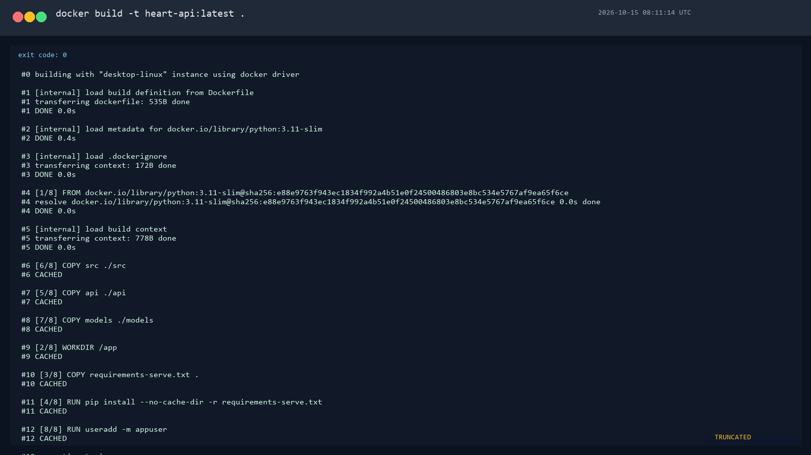

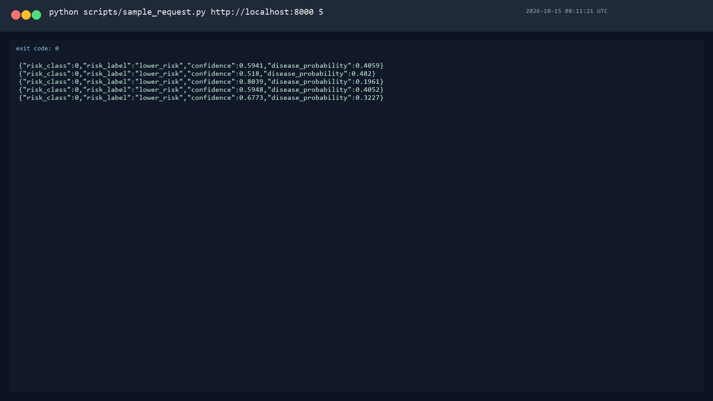

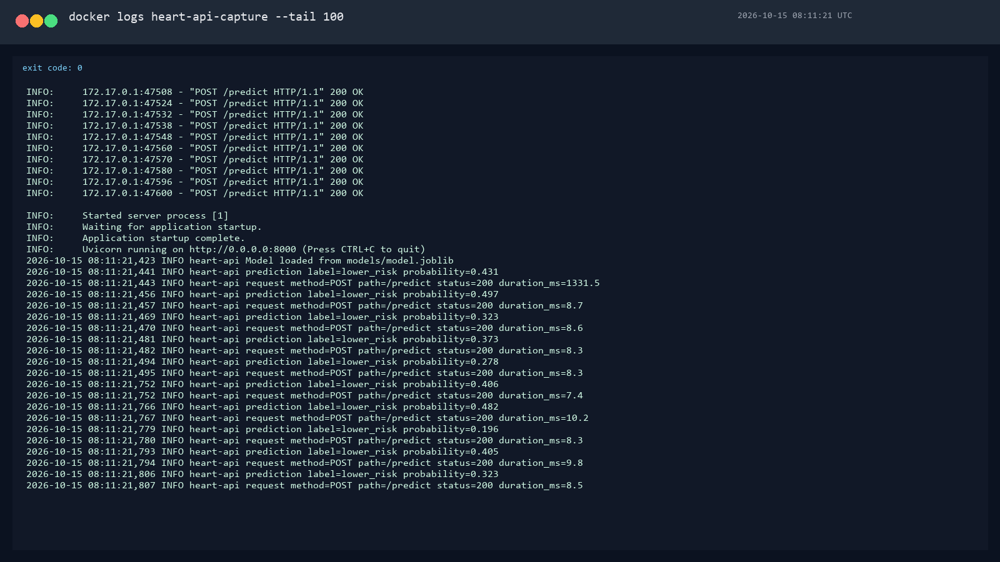

## 7. Kubernetes deployment

The Kubernetes manifest deploys two API replicas behind a `LoadBalancer`
service. Readiness and liveness probes call `/health`; each container requests
100m CPU and 256 MiB memory, with limits of 500m CPU and 512 MiB. The deployment
was applied to Docker Desktop Kubernetes, both pods reached `Ready`, and a
sample prediction succeeded through a local port-forward.

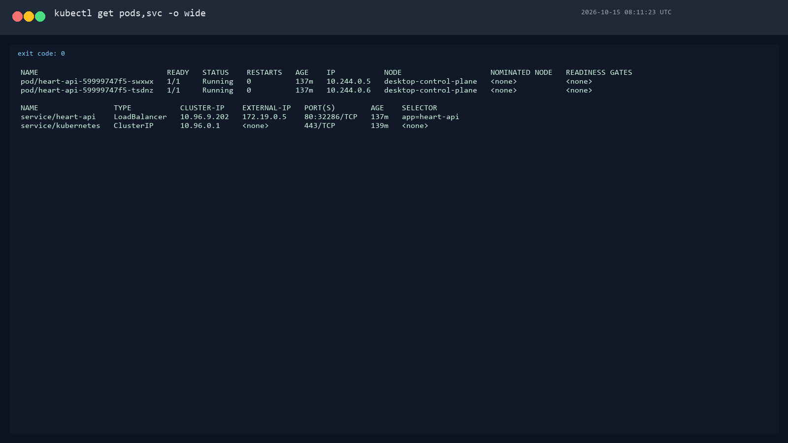

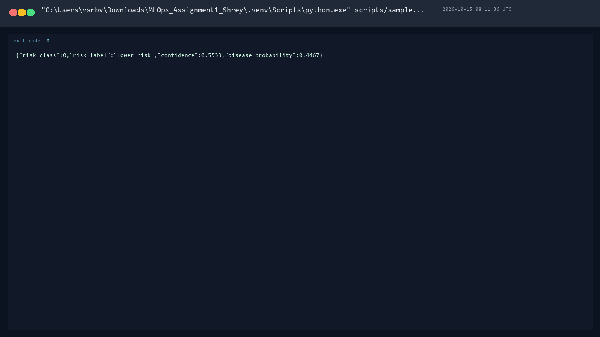

## 8. Monitoring and logging

Prometheus scrapes the API metrics endpoint every five seconds. Its live target
status showed the `heart-api` target up. The provisioned Grafana dashboard
visualizes request rate, p95 latency, predictions by risk label, and failures.

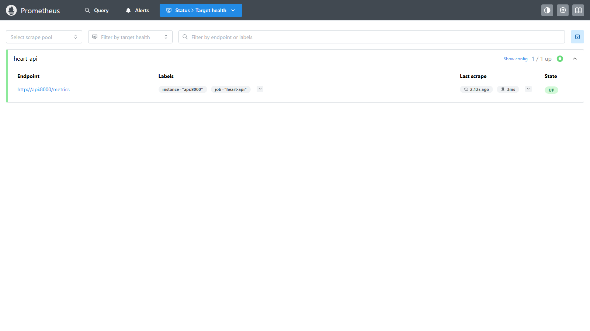

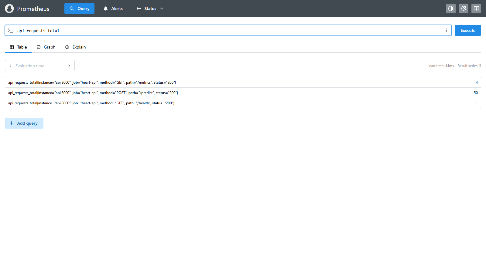

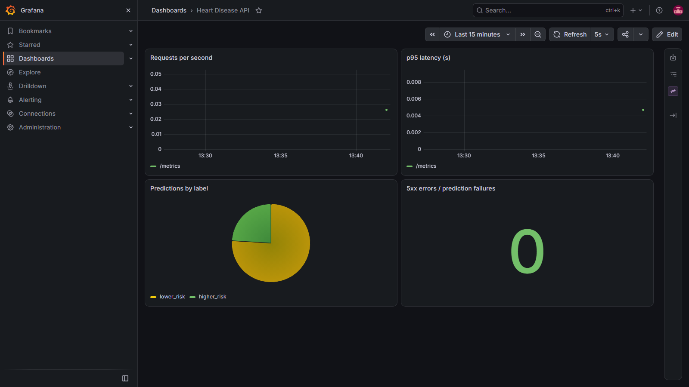

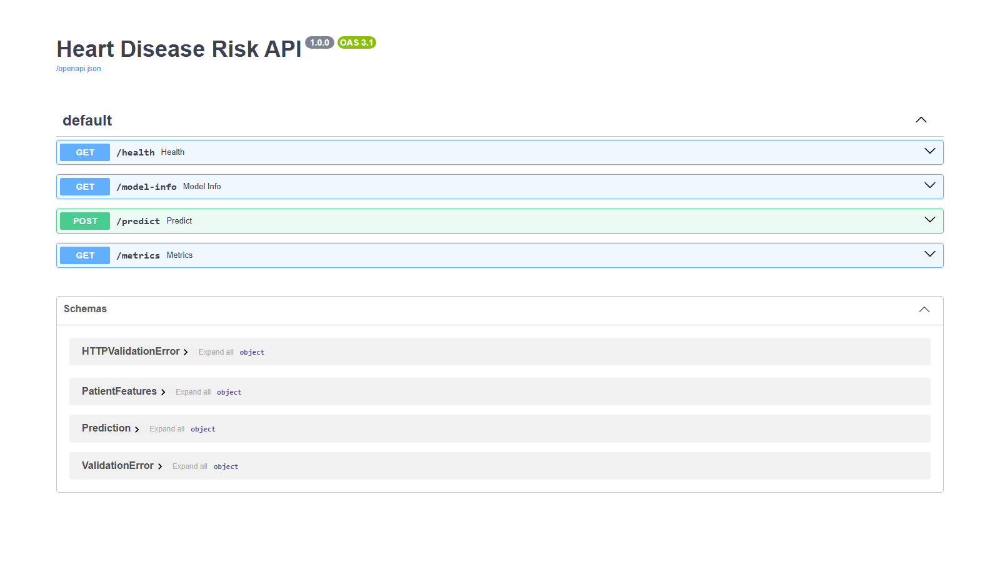

## 9. Architecture

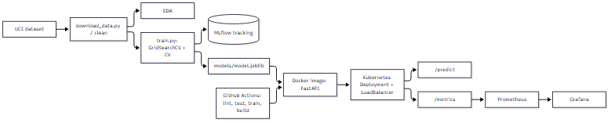

## 10. Local access and submission status

Start services with `docker compose up --build`; the API, Prometheus, and
Grafana are available on ports 8000, 9090, and 3000. Access the Kubernetes
deployment locally with `kubectl port-forward svc/heart-api 8001:80`. The video
recording was not supplied in the report configuration and remains a separate
assignment deliverable.

## Conclusion

The assignment requirements for data preparation, EDA, feature engineering,
three-model evaluation, MLflow tracking, reproducible packaging, CI/CD, unit
testing, Docker serving, local Kubernetes deployment, monitoring, and logging
were exercised on this machine. The evidence comes from those live runs.
